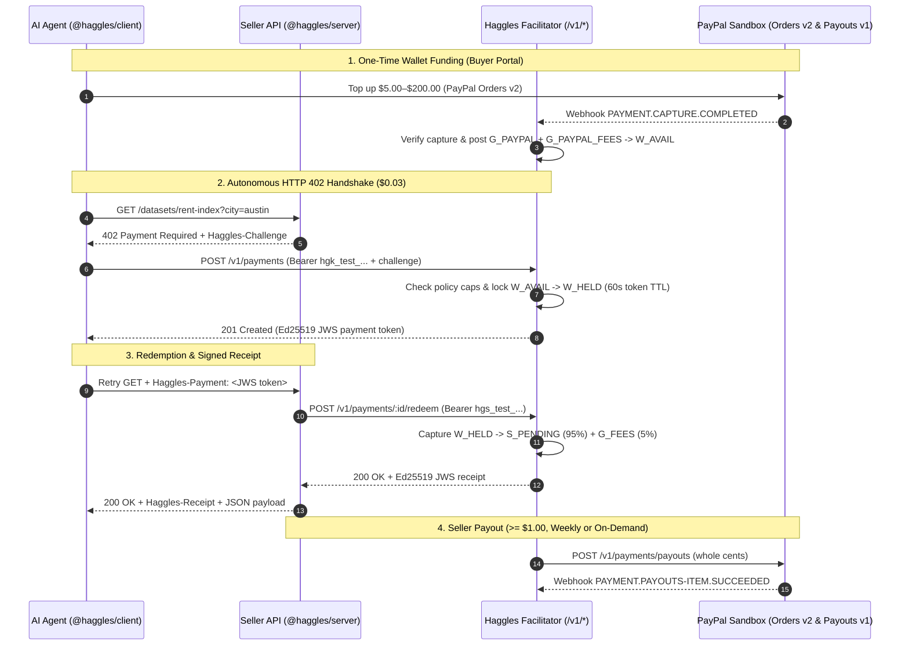

# Haggles — HTTP `402 Payment Required` for AI Agents on PayPal Rails

[](./LICENSE)
[-E08B3E.svg)](./SPEC.md)
[](https://bun.sh)

**Haggles** lets any developer put a price on an HTTP endpoint (`$0.0001` to `$5.00` per call) in two lines of middleware and get paid in real USD via **PayPal** by AI agents that pay automatically within server-enforced spending policies (`per_call_max`, `daily_max`, `monthly_max`, `allowed_sellers`, `allowed_hosts`) controlled by their owners. Because per-call PayPal checkout is uneconomic below ~$1 due to fixed transaction fees and human approval latency, Haggles separates **wallet funding** (PayPal Orders v2), **per-call micro-settlement** (an append-only double-entry micro-dollar ledger with Ed25519 JWS tokens and receipts), and **seller disbursement** (PayPal Payouts v1).

---

## Architecture & Wire Protocol Flow



---

## 5-Minute Quickstart: Sell an API (`@haggles/server`)

Install the seller middleware (`@haggles/server` supports both **Hono** and **Express**):

```bash
bun add @haggles/server @haggles/core
```

Add `paywall` to any route (`examples/seller-datasets/src/index.ts`):

```ts
import { Hono } from "hono";
import { getHagglesPayment, paywall } from "@haggles/server/hono";

const app = new Hono();

const haggles = paywall({
  sellerKey: process.env.HAGGLES_SELLER_KEY!,
  sellerId: process.env.HAGGLES_SELLER_ID!,
  facilitatorUrl: process.env.HAGGLES_FACILITATOR_URL ?? "http://localhost:3001",
  publicBaseUrl: "http://localhost:4010",
});

app.get(
  "/datasets/rent-index",
  haggles({ price: "0.03", description: "Sample US metro median rent index" }),
  (c) => {
    const payment = getHagglesPayment(c);
    return c.json({
      city: c.req.query("city") ?? "austin",
      medianMonthlyRentUsd: 1640,
      paymentId: payment?.paymentId,
    });
  },
);
```

---

## 5-Minute Quickstart: Buy from an AI Agent (`@haggles/client`)

Install the buyer SDK:

```bash
bun add @haggles/client @haggles/core
```

Wrap `fetch` with `createHaggles` (`examples/buyer-research-agent/src/index.ts`):

```ts
import { createHaggles, readReceipt } from "@haggles/client";

const haggles = createHaggles({
  agentKey: process.env.HAGGLES_KEY!, // hgk_test_...
  facilitatorUrl: process.env.HAGGLES_FACILITATOR_URL ?? "http://localhost:3001",
  maxPricePerCall: "0.05",
});

const response = await haggles.fetch("http://localhost:4010/datasets/rent-index?city=austin");
const data = await response.json();
const receipt = readReceipt(response);
console.log({ data, paymentId: receipt?.paymentId, amountPaid: receipt?.amount });
```

---

## Run Locally (`docker compose` + `bun`)

### 1. Start Postgres 16 & Redis 7 (optional — tests and local dev also run in-memory with `PAYPAL_MODE=mock`)

```bash
cp .env.example .env
docker compose up -d
```

### 2. Install dependencies & seed demo data

```bash
bun install
bun scripts/seed.ts
```

`bun scripts/seed.ts` provisions two demo sellers (`seller-datasets` and `seller-poems`), a funded buyer wallet (`$25.00`), an active agent key (`$0.05` daily cap so the policy guardrail is demonstrable after 2 calls), and sample captured/refunded ledger entries.

### 3. Run the Facilitator API, Portal UI, Demo Sellers & Buyer Research Agent

```bash
# Start Facilitator API (:3001) and Next.js Portal (:3000)
bun run dev

# Or run the end-to-end demo apps:
bun examples/seller-datasets/src/index.ts        # Hono seller on :4010
bun examples/seller-poems/src/index.ts           # Express seller on :4011
bun examples/buyer-research-agent/src/index.ts   # AI Research Agent UI on :4012
```

### 4. View the Documentation Site (`apps/docs`)

Our documentation in [`apps/docs/`](./apps/docs) is built for **Mintlify** (`docs.json` / `mint.json` + `.mdx` pages with `mermaid` diagrams, Space Grotesk typography, and Tabler icons) and also includes a zero-config static HTML + `llms.txt` + `llms-full.txt` builder:

```bash
cd apps/docs && npx mintlify dev
```

---

## Repository Structure

| Path | Package | Description |
|---|---|---|
| [`packages/core`](./packages/core) | `@haggles/core` | Micro-dollar `bigint` math (`$1.00 = 1,000,000` micros), RFC 3986 URL canonicalization, Ed25519 JWS tokens/receipts, RFC 9457 error catalogue, and shared `test-vectors/` |
| [`packages/client`](./packages/client) | `@haggles/client` | Buyer SDK (`createHaggles`, `readReceipt`) with SSRF guard, body replay guard, and client-side ceiling check |
| [`packages/server`](./packages/server) | `@haggles/server` | Seller paywall middleware for **Hono** (`@haggles/server/hono`) and **Express** (`@haggles/server/express`) with JWKS caching, fail-closed verification, and auto-refund on `5xx` |
| [`apps/api`](./apps/api) | `@haggles/api` | Fastify v5 Facilitator (`/v1/*`), Portal API (`/portal/v1/*`), double-entry ledger, PayPal Orders v2 + Payouts v1 + OIDC + Webhooks, and background worker (`src/worker.ts`) |
| [`apps/portal`](./apps/portal) | `@haggles/portal` | Next.js 16 + React 19 Buyer Wallet & Seller Studio with interactive WebGL2 liquid sculpture landing page, **AG Grid Community** data tables, and strict per-request CSP nonces |
| [`apps/docs`](./apps/docs) | `@haggles/docs` | Mintlify documentation site (`docs.json`, 17 `.mdx` pages, `llms.txt`, `llms-full.txt`, `openapi.json`, and compiled code snippets) |
| [`examples/seller-datasets`](./examples/seller-datasets) | `@haggles/example-seller-datasets` | Demo Hono seller serving US metro rent & transit datasets (`$0.03` and `$0.01`) |
| [`examples/seller-poems`](./examples/seller-poems) | `@haggles/example-seller-poems` | Demo Express seller serving public-domain poems (`$0.005` and `$0.02`) |
| [`examples/buyer-research-agent`](./examples/buyer-research-agent) | `@haggles/example-buyer-research-agent` | Demo AI Research Assistant (Vercel AI SDK + Gemini on Vertex AI) with live Spend panel and interactive policy-cap guardrail |

---

## Hackathon Tools & Sponsor Integrations (`SPEC.md` § 16.3)

Built for the **Build What's Next with PayPal and AI** hackathon:

1. **PayPal Developer Platform (`apps/api/src/paypal/gateway.ts`)**:
   - **Log in with PayPal (OIDC)**: Authenticates buyers and sellers via `/v1/oauth2/token` and `/v1/identity/oauth2/userinfo?schema=paypalv1.1` (`payer_id` + verified email).
   - **PayPal Orders v2**: Funds buyer prepaid wallets (`/v2/checkout/orders` + `/capture`) with `PayPal-Request-Id` idempotency and exact fee breakdown (`seller_receivable_breakdown`).
   - **PayPal Payouts v1**: Disburses seller earnings (`/v1/payments/payouts`) to `PAYPAL_ID` recipients with crash-safe `sender_batch_id` (`hgb_<ULID>`) duplicate recovery.
   - **PayPal Webhooks v1**: Cryptographically verifies `PAYMENT.CAPTURE.*` and `PAYMENT.PAYOUTS-ITEM.*` events via `/v1/notifications/verify-webhook-signature` and re-fetches authoritative state from PayPal before posting to the ledger.
2. **AI & Agentic Commerce (`examples/buyer-research-agent` & `@haggles/client`)**:
   - Uses **Gemini on Google Cloud Vertex AI** (`@ai-sdk/google-vertex` + Vercel AI SDK `generateText` tool-calling) equipped with `list_sources` and `buy_source(url)` tools, governed by server-enforced per-key spending policies.
3. **AG Grid Community (`apps/portal/components/haggles/data-table.tsx`)**:
   - Powers all 7 tabular views across the Buyer Wallet and Seller Studio (`topups`, `buyer keys`, `buyer payments`, `seller endpoints`, `seller calls`, `seller payouts`, `seller keys`) with theme-aware CSS variables, sorting, filtering, and keyboard navigation.
4. **Render (`render.yaml`)**:
   - Complete multi-service Render Blueprint deploying Postgres 16 (`haggles-db`), Redis Key-Value (`haggles-kv`), `haggles-api`, `haggles-worker`, `haggles-portal`, `haggles-docs`, and all three demo services.

---

## Honest Assumptions & Limitations (`SPEC.md` §§ 1.4, 2.2, 17.1)

- **Why Prepaid Wallets (Assumption A1):** Direct PayPal checkout on sub-cent or `$0.02` API calls is uneconomic due to fixed payment processing fees and human approval latency. Haggles batches funding via PayPal Orders v2 and disbursements via PayPal Payouts v1 while settling individual API calls on a double-entry micro-dollar ledger.
- **Regulatory Scope (Risk R3):** Holding prepaid balances and paying out third-party sellers in live production may require money-transmission or stored-value licensing depending on jurisdiction. This repository is configured strictly for **PayPal Sandbox** (`PAYPAL_MODE=sandbox` or `mock`) with hard balance caps (`$200` max top-up, `$500` max wallet balance, `$5.00` max per call).
- **Non-Goals in v1:** No cryptocurrency, no blockchain, no custom token/coin, no multi-round price haggling, and no streaming per-token billing in v1.

---

## License

Released under the [MIT License](./LICENSE).
