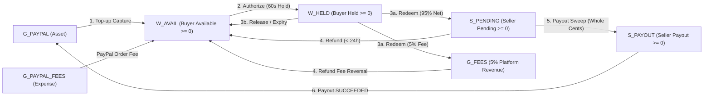

All monetary values inside Haggles are stored as signed 64-bit integer **micro-dollars** (`1 USD = 1,000,000 micros`). Floating-point numbers (`number` for currency) are forbidden across the entire codebase.

## Double-Entry Flow Across Account Kinds



## The Ledger Account Kinds (`SPEC.md` § 6.2)

| Account Kind | Normal Balance | Non-Negative Guard | Purpose |
|---|---|---|---|
| `G_PAYPAL` | Debit (Asset) | No | PayPal omnibus cash clearing account |
| `G_PAYPAL_FEES` | Debit (Expense) | No | PayPal Orders v2 & Payouts v1 processing fees |
| `W_AVAIL` | Credit (Liability) | **Yes (`>= 0`)** | Buyer wallet available balance |
| `W_HELD` | Credit (Liability) | **Yes (`>= 0`)** | Buyer funds locked in active 60-second authorizations |
| `S_PENDING` | Credit (Liability) | **Yes (`>= 0`)** | Seller net earnings (95%) including sub-cent micro-dollar dust |
| `S_PAYOUT` | Credit (Liability) | **Yes (`>= 0`)** | Seller whole-cent funds in an active PayPal Payout batch |
| `G_FEES` | Credit (Revenue) | No | Haggles 5% facilitator revenue (`PLATFORM_FEE_BPS = 500`, half-even rounding) |

## Global Conservation Invariant

Every ledger transaction is enforced by a PostgreSQL `CONSTRAINT TRIGGER ... DEFERRABLE INITIALLY DEFERRED` verifying `SUM(debit) == SUM(credit)` at commit time, and an hourly invariant check verifies:

```text
G_PAYPAL + G_PAYPAL_FEES == sum(W_AVAIL) + sum(W_HELD) + sum(S_PENDING) + sum(S_PAYOUT) + G_FEES
```
