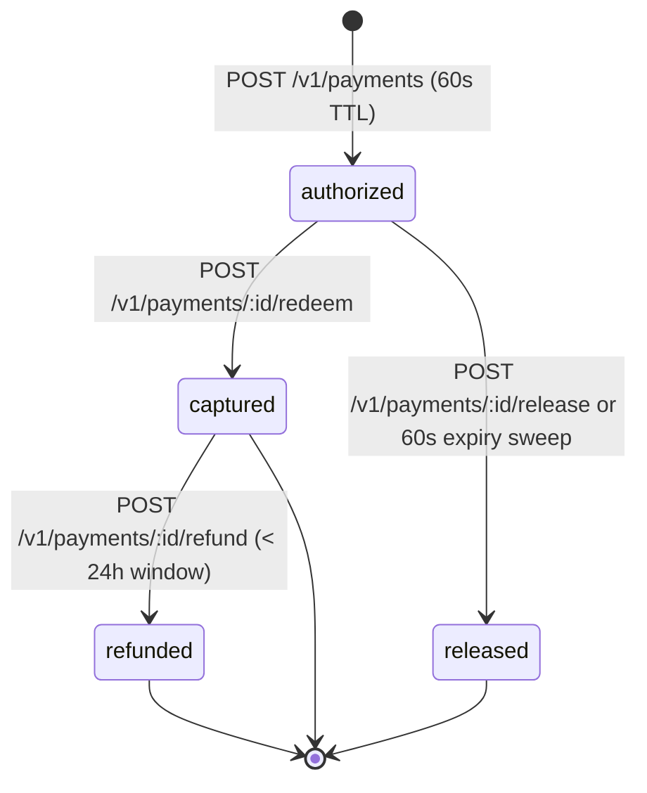

Every payment transitions through a deterministic state machine backed by idempotent double-entry ledger postings (`SPEC.md` §§ 4, 6).

## Lifecycle Guarantees

- **60-Second Hold TTL:** When `POST /v1/payments` authorizes a challenge, `amount` moves from `W_AVAIL` to `W_HELD` and increments `spent_today` / `spent_month`. If the token is not redeemed within 60 seconds, the hold expires and both `W_AVAIL` and the policy spend counters are restored.
- **Automatic 5xx Refund:** If a seller's downstream handler throws an exception or returns `HTTP >= 500` after redeeming a token, `@haggles/server` automatically calls `POST /v1/payments/:id/refund` in the background.
- **24-Hour Full Refund Window:** Captured payments can be refunded in full within 24 hours (`S_PENDING` net + `G_FEES` 5% fee are both reversed back to the buyer's `W_AVAIL`).
