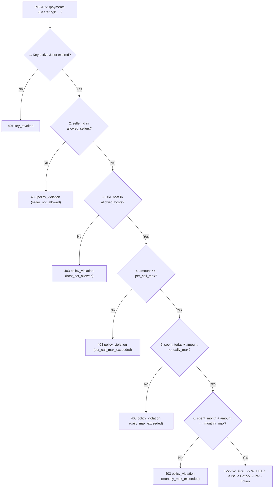

Every buyer agent key (`hgk_<env>_...`) carries a server-enforced spending policy evaluated inside the same serializable transaction that locks `W_AVAIL`.

## Policy Evaluation Order (`SPEC.md` § 5.3)

| Order | Rule | Default | Error Code & Detail |
|---|---|---|---|
| 1 | Key status & `expires_at` | `active`, no expiry | `401 key_revoked` |
| 2 | `allowed_sellers` | `null` (any seller) | `403 policy_violation` (`seller_not_allowed`) |
| 3 | `allowed_hosts` | `null` (any host) | `403 policy_violation` (`host_not_allowed`) |
| 4 | `per_call_max` | `$0.10` | `403 policy_violation` (`per_call_max_exceeded`) |
| 5 | `daily_max` (UTC day) | `$5.00` | `403 policy_violation` (`daily_max_exceeded`) |
| 6 | `monthly_max` (UTC month) | `null` (unlimited) | `403 policy_violation` (`monthly_max_exceeded`) |
