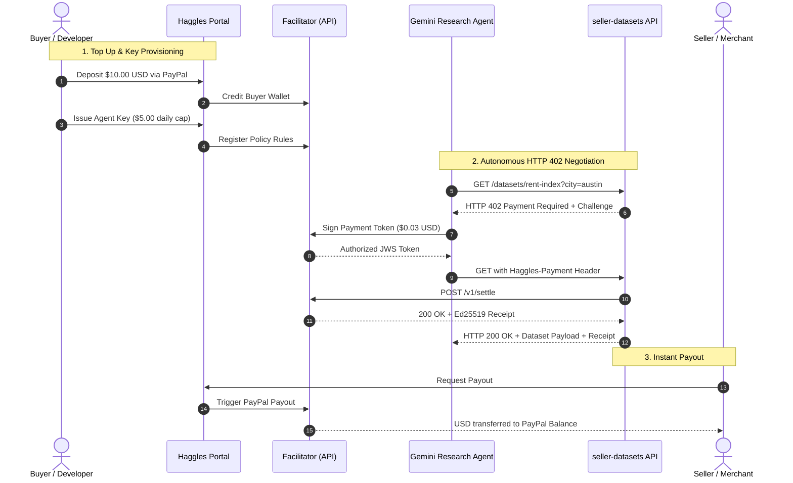

This guide provides the complete setup to run and reproduce the live **Haggles Demo** seen in the video showcase. 

By following these steps, you will:
1. Top up a prepaid Buyer Wallet using **PayPal Sandbox**.
2. Issue a scoped **Agent Key** with policy limits.
3. Protect an existing API with 2 lines of middleware in **Hono or Express**.
4. Run an autonomous **Google Gemini Research Agent** that negotiates HTTP 402 challenges and settles micro-payments in real USD.
5. Withdraw earned seller revenue directly back to your **PayPal** account.

---

## Architecture Flow



---

## Prerequisites

Before starting, ensure you have:
* [Bun](https://bun.sh) (`v1.2+`) installed.
* A free [PayPal Developer Sandbox](https://developer.paypal.com) account.
* A [Google Gemini API Key](https://aistudio.google.com).

---

## Step 1: Fund Buyer Wallet & Create Agent Key

1. Navigate to the **Haggles Portal**: [haggles-portal.onrender.com](https://haggles-portal.onrender.com).
2. Log in using your PayPal Sandbox account.
3. Go to **Buyer > Wallet** (`/buy/wallet`):
   * Click **Add Funds**.
   * Approve a `$10.00` sandbox deposit. The ledger credits your prepaid USD balance instantly.
4. Go to **Buyer > Agent Keys** (`/buy/keys`):
   * Click **Create Key**.
   * Set **Name**: `Research Agent`.
   * Set **Daily Cap**: `$5.00`.
   * Set **Per-Call Max**: `$0.10`.
   * Copy the generated key: `hgk_test_...`.

<Tip>
  **Policy Safety:** Leaving "Allowed Sellers" empty permits the agent to pay any verified seller. To restrict the agent to specific vendors, paste your Seller ID (`slr_...`).
</Tip>

---

## Step 2: Set Up Seller API (`seller-datasets`)

The seller exposes public and paywalled endpoints using `@haggles/server`.

```ts
import { Hono } from "hono";
import { paywall } from "@haggles/server/hono";

const app = new Hono();

// Free Route
app.get("/datasets/summary", (c) => c.json({ status: "active" }));

// Paid Route ($0.03 USD)
app.get(
  "/datasets/rent-index",
  paywall({
    price: "0.03",
    description: "City apartment rent index ($0.03)",
  }),
  (c) => c.json({ city: "Austin", median_1br_usd: 1620 })
);
```

### Launch the Seller Service:
1. Open your terminal in the repo root:
```bash
cd examples/seller-datasets
export HAGGLES_FACILITATOR_URL="https://haggles-api.onrender.com"
export HAGGLES_SELLER_ID="your_seller_id_from_portal"
export HAGGLES_SELLER_KEY="your_seller_key_from_portal"
export PUBLIC_BASE_URL="http://localhost:4010"
bun start
```
The seller is now listening on `http://localhost:4010`.

---

## Step 3: Launch the Gemini Research Agent UI

The research agent queries data vendors autonomously and renders real-time receipts in a **Space Grotesk** timeline interface.

1. Open a second terminal window:
```bash
cd examples/buyer-research-agent
export GEMINI_API_KEY="your_gemini_api_key"
export HAGGLES_KEY="your_hgk_agent_key_from_step_1"
export HAGGLES_FACILITATOR_URL="https://haggles-api.onrender.com"
export SELLER_DATASETS_URL="http://localhost:4010"
bun src/server.ts
```

2. Open **`http://localhost:4012`** in your browser.
3. Click **Run Research Agent ($0.07)**:
   * **Step 1:** Discovers endpoints from `seller-datasets`.
   * **Step 2:** Transparently negotiates three HTTP 402 challenges:
     * `GET /datasets/rent-index?city=austin` (`$0.03`)
     * `GET /datasets/rent-index?city=chicago` (`$0.03`)
     * `GET /datasets/transit-fares?city=austin` (`$0.01`)
   * **Step 3:** Gemini synthesizes the purchased data into a concise comparative report.
4. Inspect the **Live Spend Panel**: Notice the sub-100ms settlement times, remaining daily allowance, and immutable Ed25519 receipt hashes.

<Note>
  Click **Test Policy Cap ($0.08)** to see the gateway block an excessive purchase on demand, proving that developers are 100% immune to runaway LLM billing loops.
</Note>

---

## Step 4: Verify Seller Revenue & Request Payout

1. Return to the **Haggles Portal**:
   * Navigate to **Seller > Endpoints** (`/sell/endpoints`): The routes `/datasets/rent-index` and `/datasets/transit-fares` appear automatically with live call volumes and revenue.
2. Navigate to **Seller > Earnings** (`/sell/earnings`):
   * View accumulated USD revenue.
   * Click **Request Payout** to transfer earnings directly to your connected PayPal account.
