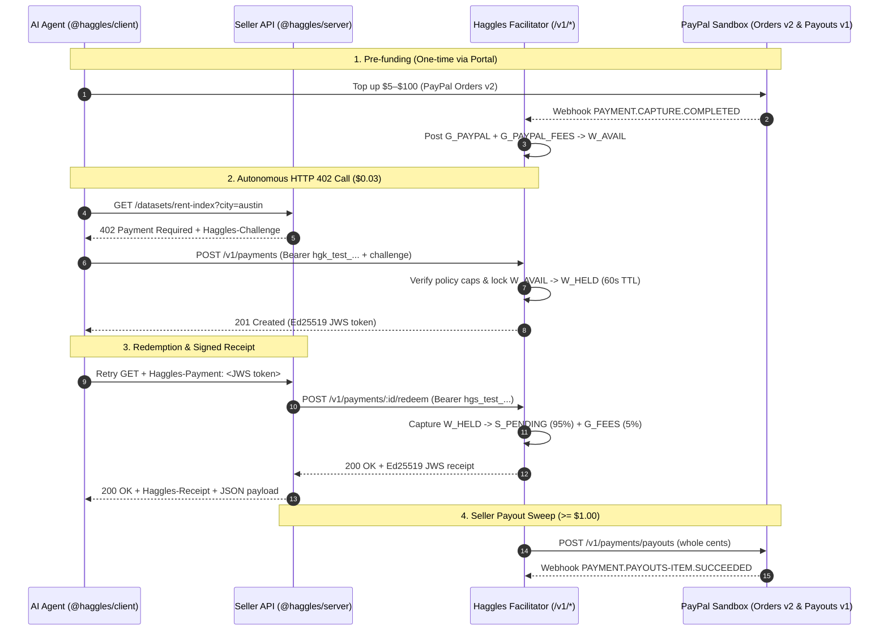

**Haggles** lets any developer put a price on an HTTP endpoint (`$0.0001` to `$5.00` per call) and get paid in real USD via **PayPal** by AI agents that pay automatically within spending policies their owners control.

<CardGroup cols={2}>
  <Card title="Quickstart: Sell (5 min)" icon="coin" href="/quickstart-sell">
    Gate any Hono or Express route behind HTTP 402 in 2 lines of middleware and receive PayPal Payouts.
  </Card>
  <Card title="Quickstart: Buy (5 min)" icon="wallet" href="/quickstart-buy">
    Fund a prepaid wallet via PayPal Orders v2, issue a policy-capped agent key, and call paid APIs with `createHaggles`.
  </Card>
  <Card title="Double-Entry Ledger" icon="activity" href="/concepts/ledger">
    Explore how integer micro-dollars (`$1.00 = 1,000,000` micros) and 6 ledger account kinds guarantee zero drift.
  </Card>
  <Card title="Wire Protocol & Test Vectors" icon="api" href="/protocol/wire-format">
    Inspect the `WWW-Authenticate: Haggles`, `Haggles-Challenge`, `Haggles-Payment`, and `Haggles-Receipt` headers.
  </Card>
</CardGroup>

## End-to-End Architecture & Protocol Flow

## Honest Assumptions & Known Limitations

<Note>
  **Assumption A1 (Micro-payment Economics):** Charging PayPal Orders directly on every `$0.005` or `$0.02` API call is impossible due to fixed per-transaction fees and human checkout latency. Haggles solves this by separating **funding** (PayPal Orders v2 into a prepaid wallet), **per-call settlement** (sub-cent double-entry ledger postings), and **disbursement** (PayPal Payouts v1 to sellers).
</Note>

<Warning>
  **Regulatory Scope (Risk R3):** Holding prepaid balances and paying out third-party sellers in live production can implicate money-transmission or stored-value licensing. This hackathon project runs strictly on **PayPal Sandbox** (`PAYPAL_MODE=sandbox` or `mock`) with hard safety caps (`$100.00` max top-up, `$500.00` max wallet balance, `$5.00` max per call).
</Warning>

- **Non-Goals (`SPEC.md` § 1.4):** No cryptocurrency, no blockchain, no custom token/coin, no streaming per-token billing in v1, and no public marketplace directory in v1.
